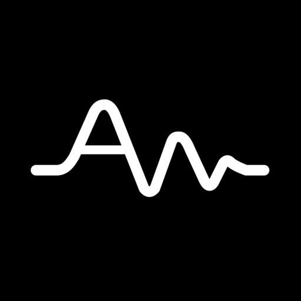
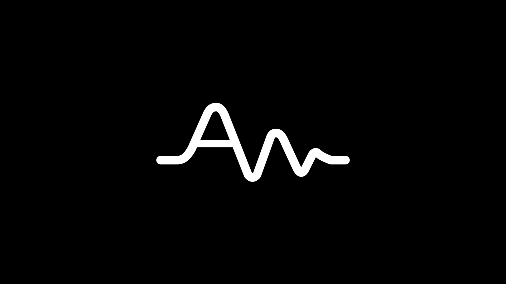

<div align="center">

<br/>



# Auden

### A YouTube Music client with a real local library

<br/>

[](https://github.com/Yahel0506/Auden/releases)
[](LICENSE)
[](https://github.com/Yahel0506/Auden/releases)

<br/>

[**Features**](#features) · [**Platforms**](#platforms) · [**Download**](#download) · [**Build**](#build) · [**Contributing**](#contributing) · [**Disclaimer**](#disclaimer)

</div>

> [!IMPORTANT]
> Auden is not affiliated with, endorsed by, or connected to YouTube or Google in any way. Use it at your own discretion.

---

Auden is a fork of [BitChord](https://github.com/kushagrasinghx/BitChord). It keeps BitChord's Apple Music–style player, word-synced lyrics and YouTube Music streaming, and adds the library management of a dedicated local player: an indexed on-device library, local playlists that work without signing in, organised downloads, per-song lyrics control, a hybrid Home, and an on-device AI DJ.

<div align="center">



</div>

---

<h2><a id="features"></a>Features</h2>

### Local library
- **Indexed library** — an incremental indexer fills `AudenDb` (Room) from MediaStore and your chosen folders, with Genres and Folders tabs.
- **Local playlists, no account needed** — create, edit and reorder playlists; remove songs from device playlists; mosaic covers.
- **Identify what you already own** — match local files to songs, split multi-artist tags, and link streamed songs to files already on the device.
- **Import / export playlists** — M3U8, XSPF and Auden JSON.
- **Backup and restore** the whole local library.

### Downloads
- **Organised folders** from a configurable template, with playlist files for releases.
- **Rich tags** — album artist, track, disc, year and source link written into each file.
- **Lyrics and `cover.jpg` beside each song**, in a folder you can open from any file manager.
- **Persistent queue** with retries and back-off, pause, and adjustable concurrency.

### Lyrics
- **Word-synced lyrics** from many providers, stored per provider as variants.
- **Per-song choice and timing** — pick the provider and offset for each song, and manage them from the player's provider sheet.
- **Batch lookup**, sidecar `.lrc` / `.ttml` files and embedded tags for offline use.

### Auden DJ
- **Themed sets** that start from Home and queue like music, each opening with a reason about the listener and the song it begins on.
- **Spoken in Spanish or English** — the DJ speaks through Fish Audio (needs a `FISH_API_KEY` in a git-ignored `.env` at the repo root, see `.env.example`); without one the DJ plays and its words are on screen.

### Home and Spotify
- **Hybrid Home** — local shelves mixed with YouTube Music's recommendations.
- **Spotify import** — read-only library access, remembered matches with manual correction, albums and artists, and saved playlists that keep themselves up to date (additive, never destructive).

### Player
- Gapless playback with crossfade, Automix beat-matching, playback speed, skip silence, sleep timer and system equalizer.
- Artwork-driven Material theming, a full-cover blur backdrop, and an output pill that shows the real output device.
- Scrobbling to Last.fm and ListenBrainz, and Discord Rich Presence.

---

<h2><a id="platforms"></a>Platforms</h2>

| Target | Module | Notes |
| --- | --- | --- |
| Android phone | [`app/`](app) | The main app (`dev.auden.app`) |
| Android TV / Google TV | [`tv/`](tv) | Remote-first interface, see its [README](tv/README.md) |
| Wear OS | [`wearos/`](wearos) | Watch remote and speaker, see its [README](wearos/README.md) |
| Web + browser extension | [`web/`](web) | Vite + React player, see its [README](web/README.md) |
| Listen Together server | [`backend/`](backend) | Go party server, see its [README](backend/README.md) |

Shared code lives in [`shared/`](shared) and [`sharedUi/`](sharedUi); native audio analysis and FFmpeg are in [`native/`](native).

---

<h2><a id="download"></a>Download</h2>

Grab the latest signed APK from the [Releases](https://github.com/Yahel0506/Auden/releases) page. Sideloading requires enabling "Install unknown apps" for whichever app you download it with. The app checks the Auden repository for updates.

---

<h2><a id="build"></a>Build</h2>

You need JDK 17+ and the Android SDK.

```bash
./gradlew :app:assembleProdDebug     # phone
./gradlew :tv:assembleProdDebug      # Android TV
```

Release builds read signing details from `keystore.properties`; copy [`keystore.properties.example`](keystore.properties.example) and generate a key with [`tools/make-release-keystore.sh`](tools/make-release-keystore.sh). The plan and phase breakdown behind the fork are in [`docs/AUDEN_ROADMAP.md`](docs/AUDEN_ROADMAP.md) (in Spanish).

---

<h2><a id="contributing"></a>Contributing</h2>

Please read the [Contributing Guide](CONTRIBUTING.md) and [Code of Conduct](CODE_OF_CONDUCT.md) before opening a pull request.

[**Contributing Guide**](CONTRIBUTING.md) · [**Code of Conduct**](CODE_OF_CONDUCT.md) · [**Maintainers**](MAINTAINERS.md) · [**Additional Docs**](ADDITIONAL.md)

---

## Credits

Auden stands on [BitChord](https://github.com/kushagrasinghx/BitChord) by kushagrasinghx and its contributors. Lyrics come from community providers including LRCLIB, Musixmatch, Genius, KuGou, Megalobiz, BetterLyrics, PaxSenix and others; the Apple-like lyrics animation is based on [am-lyrics](https://github.com/binimum/am-lyrics).

---

<h2><a id="disclaimer"></a>Disclaimer & Legal Notice</h2>

Auden is an independent, community-driven third-party audio player and client. It is **not** associated with Google LLC, YouTube Music, Spotify or any of their parent companies.

* **No media hosting:** Auden does not host, upload, or store copyrighted music files. It scans local device storage and streams media from public or user-authenticated APIs.
* **Fair use:** This software is for personal research, educational and fair-use purposes. You are responsible for making sure your usage complies with your local copyright laws and the terms of the services you connect to.
* **Copyleft:** Auden is free software under the GPLv3. Any distribution must come with the Corresponding Source under the same license.

## License

Licensed under the **GNU General Public License v3.0 (GPLv3)**. See [LICENSE](LICENSE).
